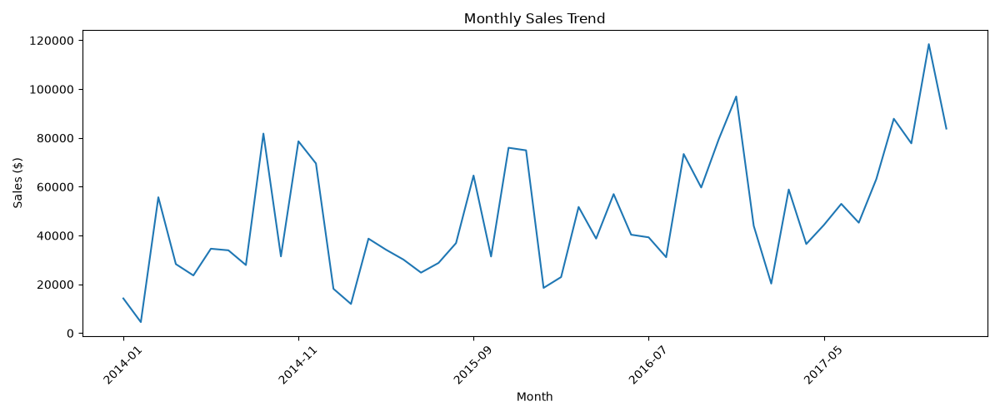

# 🛍️ RetailPulse-Analytics
### Retail Sales Analysis Using Python, SQL & Power BI

## 📌 Project Overview
RetailPulse-Analytics is a beginner-friendly data analytics project that explores retail sales data to understand sales performance, profitability, product trends, and business patterns.

The project combines Python for exploratory data analysis, SQL for querying data, and Power BI for interactive dashboard visualization.

## 🎯 Objectives
- Analyze retail sales and profit performance.
- Clean and prepare data for analysis.
- Explore monthly sales trends.
- Use SQL queries to answer business questions.
- Build an interactive Power BI dashboard.
- Present data-driven insights to support business decisions.

## 🛠️ Tools & Technologies
- **Python** — data analysis and exploration
- **Pandas** — data manipulation and cleaning
- **Matplotlib** — data visualization
- **SQL** — data querying and analysis
- **SQLite** — database management
- **Power BI** — interactive dashboards
- **Git & GitHub** — version control and project hosting

## 📂 Project Files
- `superstore.csv` — original retail dataset
- `superstore_cleaned.csv` — cleaned dataset
- `retailpulse.db` — SQLite database
- `01_retail_eda.py` — Python exploratory data analysis
- `analysis_queries.sql` — SQL analysis queries
- `monthly_sales_trend.png` — monthly sales trend visualization
- `Retail_Analytics_Dashboard.pbix` file — Power BI dashboard

## 📊 Analysis Performed
- Dataset inspection and data quality checks
- Data cleaning and preparation
- Exploratory data analysis
- Monthly sales trend visualization
- SQL-based business analysis
- Power BI dashboard development

## 💡 Business Questions
- How do sales change over time?
- Which products or categories contribute to sales?
- How do sales and profit vary across business segments?
- How do discounts relate to profitability?
- What trends can help improve business decisions?

## 📈 Dashboard
The Power BI dashboard provides visual summaries of retail performance. Open the included `.pbix` file using Power BI Desktop to explore the report.
### Monthly Sales Trend




## 🚀 How to Run
1. Clone or download this repository.
2. Install Python and the required libraries.
3. Open the Python analysis script and run it.
4. Execute the SQL queries using a compatible SQLite tool.
5. Open the `.pbix` dashboard in Power BI Desktop.

Install the Python libraries with:

```bash
pip install pandas matplotlib
```

## 📚 Key Learnings
- Data cleaning and exploratory data analysis
- SQL querying and database fundamentals
- Data visualization and dashboard development
- Communicating business questions through data

## 👩‍💻 Author
**Sarumathi S**

B.Tech — Artificial Intelligence and Data Science

Interested in Data Analytics, Machine Learning, and AI Engineering.

---

⭐ If you find this project useful, feel free to explore the repository and share feedback.
